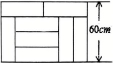

如图，8 块相同的长方形地砖拼成一个长方形，每块长方形地砖的长和宽分别是多少？

> [!question]- 点击查看答案与解析
> 【答案】长 45 cm，宽 15 cm
> 
> 【考点】二元一次方程组的应用 → [[【初中数学知识点体系-人教版】#10-3 实际问题与二元一次方程组]]
> 
> 【解析】
> 设每块长方形地砖的长为 $x$ cm，宽为 $y$ cm。
> 
> 从图中可以看出：
> 大长方形的宽 = 一块地砖的长 + 一块地砖的宽 = $x+y=60$。
> 大长方形的长 = 2 块地砖的长 = 4 块地砖的宽 + 一块地砖的长。
> $2x=x+4y$，$x=4y$。
> 
> 实际上，从图中看：大长方形的宽是 3 块地砖的宽：$x=3y$。
> 
> 如果 $x=3y$，且 $x+y=60$，则 $4y=60$，$y=15$，$x=45$。
> 
> 答案：长 45 cm，宽 15 cm。
> 
> 【易错点】正确理解图形中地砖的拼接关系，列出正确的方程组。
