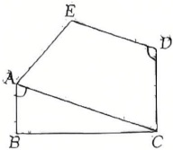

如图，已知 $AC // DE$，$\angle D+\angle BAC=180^{\circ}$

(1) 求证：$AB // CD$ ;

(2) 连接 $CE$，恰好满足 $CE$ 平分 $\angle ACD$。若 $AB \perp BC$，$\angle CED = 35^\circ$，求 $\angle ACB$ 的度数 .

> [!question]- 点击查看答案与解析
> 【答案】(1) 见解析；(2) $20^{\circ}$
> 
> 【考点】平行线的判定与性质、角平分线 → [[【初中数学知识点体系-人教版】#7-2 平行线]]
> 
> 【解析】
> (1) 证明：
> $\because AC\parallel DE$（已知），
> $\therefore \angle D+\angle ACD=180^{\circ}$（两直线平行，同旁内角互补）。
> 又 $\because \angle D+\angle BAC=180^{\circ}$（已知），
> $\therefore \angle ACD=\angle BAC$（同角的补角相等），
> $\therefore AB\parallel CD$（内错角相等，两直线平行）。
> 
> (2) $\because CE$ 平分 $\angle ACD$，$\therefore \angle ACD=2\angle CED=2\times 35^{\circ}=70^{\circ}$。
> 由 (1) 知 $AB\parallel CD$，$\therefore \angle BAC=\angle ACD=70^{\circ}$。
> $\because AB\perp BC$，$\therefore \angle ABC=90^{\circ}$。
> 在 $\triangle ABC$ 中，$\angle ACB=180^{\circ}-\angle BAC-\angle ABC=180^{\circ}-70^{\circ}-90^{\circ}=20^{\circ}$。
> 
> 【易错点】综合利用平行线的判定与性质、角平分线定义、三角形内角和定理。
