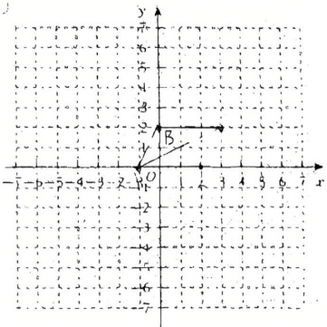

已知三角形 ABC 的三个顶点的坐标分别是 $A(-1,0)$，$B(0,2)$，$C(3,2)$ .

(1) 在所给的平面直角坐标系 $xOy$ 中画出三角形 ABC;

(2) 将线段 $AB$ 平移到 $CD$（点 $C$ 与点 $A$ 对应，点 $D$ 与点 $B$ 对应），画出 $D$ 点，则平移后对应点 $D$ 的坐标是 ___ ，并求出三角形 BCD 的面积；

(3) 若点 $P$ 在 $x$ 轴上，且三角形 ABP 的面积等于三角形 ABC 面积的 2 倍，求点 $P$ 的坐标 .

> [!question]- 点击查看答案与解析
> 【答案】(1) 略；(2) $D(4, 4)$；面积 3；(3) $(5, 0)$ 或 $(-7, 0)$
> 
> 【考点】平移、三角形面积 → [[【初中数学知识点体系-人教版】#9-2 坐标方法的简单应用]]
> 
> 【解析】
> (1) 画图略。
> 
> (2) $A(-1, 0)\to C(3, 2)$，平移向量为 $(3-(-1), 2-0)=(4, 2)$。
> $B(0, 2)\to D$：$D=(0+4, 2+2)=(4, 4)$。
> 
> 三角形 $BCD$ 的面积：
> $B(0, 2)$，$C(3, 2)$，$D(4, 4)$。
> 利用坐标公式：
> 面积 $=\frac{1}{2}|x_1(y_2-y_3)+x_2(y_3-y_1)+x_3(y_1-y_2)|$
> $=\frac{1}{2}|0(2-4)+3(4-2)+4(2-2)|$
> $=\frac{1}{2}|0+6+0|=3$。
> 
> (3) 三角形 $ABC$ 的面积：
> $A(-1, 0)$，$B(0, 2)$，$C(3, 2)$。
> $S_{\triangle ABC}=\frac{1}{2}\times 3\times 2=3$（底 $BC=3$，高为 2）。
> 
> 三角形 $ABP$ 的面积为 6。
> $P$ 在 $x$ 轴上，设 $P(p, 0)$。
> 三角形 $ABP$ 的面积：$A(-1, 0)$，$B(0, 2)$，$P(p, 0)$。
> 底 $AP=|p-(-1)|=|p+1|$，高为 2（$B$ 到 $x$ 轴的距离）。
> $S_{\triangle ABP}=\frac{1}{2}\times|p+1|\times 2=|p+1|$。
> $|p+1|=6$，$p+1=6$ 或 $p+1=-6$。
> $p=5$ 或 $p=-7$。
> 
> 所以 $P(5, 0)$ 或 $(-7, 0)$。
> 
> 【易错点】平移的性质；三角形面积公式。
