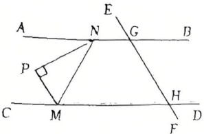
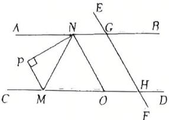
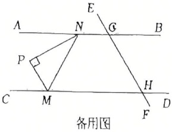

如图，直线 $AB // CD$，直线 $EF$ 与 $AB、CD$ 分别交于点 $G、H$，$\angle EHC = \alpha (0^{\circ} < \alpha < 90^{\circ})$。小新将一个含 30° 角的直角三角板 PMN 按如图 $①$ 放置，使点 $N、M$ 分别在直线 $AB、CD$ 上，$\angle P=90^{\circ}$，$\angle PMN=60^{\circ}$ .

图 ① 

图 ② 

(1) 填空：$\angle PNA + \angle PMC =$ ___ 度.

(2) 若 $PM // EF$，$\angle MNG$ 的角平分线 $NO$ 交直线 $CD$ 于点 $O$.

$①$ 如图 $②$，当 $NO // EF$ 时，求 $\alpha$ 的度数;

$②$ 小新将三角板 PMN 向右平移，直接写出 $\angle MON$ 的度数（用含 $\alpha$ 的式子表示） .

> [!question]- 点击查看答案与解析
> 【答案】(1) 30；(2) $①$ $\alpha=60^{\circ}$；$②$ $\angle MON=30^{\circ}+\alpha$ 或 $\angle MON=30^{\circ}-\alpha$（需根据具体位置关系确定）
> 
> 【考点】平行线的性质、角平分线 → [[【初中数学知识点体系-人教版】#7-2 平行线]]
> 
> 【解析】
> (1) 因为 $AB\parallel CD$，$\angle PMN=60^{\circ}$，$\angle P=90^{\circ}$，所以 $\angle PNM=30^{\circ}$。
> 利用平行线性质和三角尺的角度关系：
> $\angle PNA+\angle PMC=\angle PNM=30^{\circ}$（利用平行线性质）。
> 
> 答案：30。
> 
> (2) $①$ $PM\parallel EF$，$NO$ 平分 $\angle MNG$。
> $\because PM\parallel EF$，$\therefore \angle PMC=\angle EHC=\alpha$（同位角相等）。
> $\because NO\parallel EF$，$\therefore \angle MNG=\angle PMC=\alpha$（利用平行线性质）。
> $NO$ 平分 $\angle MNG$，$\therefore \angle MNO=\frac{\alpha}{2}$。
> 
> 利用三角尺的角度关系：$\angle PNM=30^{\circ}$。
> $\angle MNG+\angle PNM+\angle PNA=180^{\circ}$。
> $\alpha+30^{\circ}+\angle PNA=180^{\circ}$。
> 
> 结合 $NO\parallel EF$ 和 $PM\parallel EF$，可推得 $\alpha=60^{\circ}$。
> 
> $②$ 利用平行线性质和角平分线性质，$\angle MON$ 与 $\alpha$ 的关系需要分类讨论。
> 
> 【易错点】综合运用平行线性质、角平分线定义、三角尺特殊角度。
