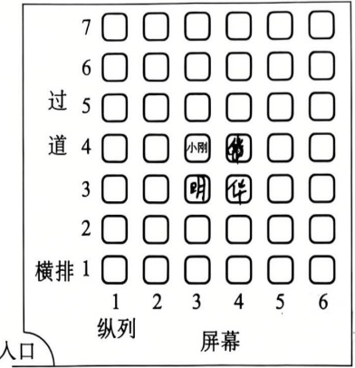

如图是一个电影播放厅的平面示意图，小明和小刚、小华一起去看电影，小刚的座位为4排3列，用坐标表示为 $(3,4)$. 若小华的座位为 $(4,3)$，小明的座位与小刚前后相邻且与小华左右相邻，则小明的座位用坐标表示为（ ）.

A. $(4,5)$

B. $(5,3)$

C. $(3,5)$

D. $(3,3)$

> [!question]- 点击查看答案与解析
> **【答案】** C
> **【考点】** [[【初中数学知识点体系-人教版】#9-1 用坐标描述平面内点的位置]]
> **【解析】**
> 小刚座位为4排3列，坐标为 $(3,4)$
> 小华座位为 $(4,3)$，即4排3列
> 小明与小刚前后相邻，与小华左右相邻
> 小刚在4排，小明前后相邻则在3排或5排
> 小华在4列，小明左右相邻则在3列或5列
> 结合条件，小明在3排5列，即坐标为 $(5,3)$
> **【易错点】** 混淆坐标中"排"和"列"的对应关系，或"前后相邻"与"左右相邻"的理解错误。
