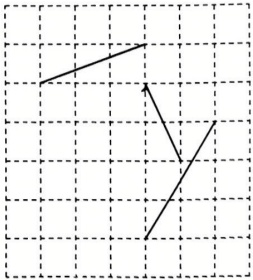

如图，如果将图中任意一条线段沿方格线的水平或竖直方向平移1格称为“1步”，那么通过平移要使图中的3条线段首尾相接组成一个三角形，最少需要（）.

A. 4 步

B. 5 步

C. 6 步

D. 7 步

## 二、填空题

> [!question]- 点击查看答案与解析
> **【答案】** B
> **【考点】** [[【初中数学知识点体系-人教版】#7-4 平移]]
> **【解析】**
> 图中3条线段需要首尾相接组成三角形
> 通过平移使线段端点重合
> 分析各线段的端点位置，计算最少平移步数
> 最优方案需要5步
> **【易错点】** 不能准确分析平移路径，或计算平移步数时遗漏某些步骤。
