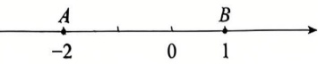

如图，数轴上点 $A$，$B$ 对应的数分别为 $-2$，$1$，点 $C$ 在线段 $AB$ 上运动.请你写出点 $C$ 可能对应的一个无理数是 ___ .

> [!question]- 点击查看答案与解析
> **【答案】** $\sqrt{2}$（答案不唯一）
> **【考点】** [[【初中数学知识点体系-人教版】#8-3 实数及其简单运算]]
> **【解析】**
> 点A对应 $-2$，点B对应 $1$
> 点C在线段AB上，即 $-2 \leq x_C \leq 1$
> 需要写出一个在此范围内的无理数
> 例如 $\sqrt{2} \approx 1.414$ 不在此范围内
> 可取 $-\sqrt{2} \approx -1.414$，在范围内
> **【易错点】** 没有考虑无理数必须在指定范围内，或计算错误导致数值超出范围。
