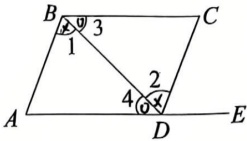

如图，给出下列选项：$①$ $\angle 1=\angle 2$；$②$ $\angle 3=\angle 4$；$③$ $\angle A=\angle CDE$；$④$ $\angle ADC+\angle C=180^\circ$. 其中，能推出 $AD \parallel BC$ 的选项是 ___ .（填上所有符合条件的选项序号）

> [!question]- 点击查看答案与解析
> **【答案】** $①②③$
> **【考点】** [[【初中数学知识点体系-人教版】#7-2 平行线]]
> **【解析】**
> 选项$①$：$\angle 1=\angle 2$，根据内错角相等，两直线平行，可得 $AD//BC$
> 选项$②$：$\angle 3=\angle 4$，根据内错角相等，两直线平行，可得 $AD//BC$
> 选项$③$：$\angle A=\angle CDE$，根据同位角相等，两直线平行，可得 $AD//BC$
> 选项$④$：$\angle ADC+\angle C=180^\circ$，这是 $AD//BC$ 的结论而非条件
> **【易错点】** 混淆平行线的判定与性质，或不能准确识别角的位置关系。
