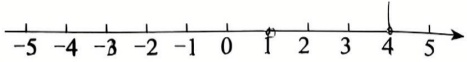

解不等式组 $\begin{cases} x - 4 >-3 \\ \frac{5x + 1}{3} - 3 \leqslant x \end{cases}$ 并把它的解集在数轴上表示出来.

> [!question]- 点击查看答案与解析
> **【答案】**$-1 < x \leqslant 2$
> **【考点】** [[【初中数学知识点体系-人教版】#11-3 一元一次不等式组]]
> **【解析】**
> 解不等式 $①$：$x-4>-3$
> $x>1$
> 解不等式 $②$：$\frac{5x+1}{3}-3 \leqslant x$
> $5x+1-9 \leqslant 3x$
> $2x \leqslant 8$
> $x \leqslant 4$
> 不等式组的解集为 $1 < x \leqslant 4$
> **【易错点】**去分母时漏乘，或移项时符号错误。
