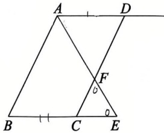

如图，$AD \parallel BC$，$\angle BAD$ 的平分线交 $CD$ 于点 $F$，交 $BC$ 的延长线于点 $E$，$\angle CFE=\angle E$. 求证：$\angle B+\angle BCD=180^{\circ}$.

请将下面的证明过程补充完整：
证明：∵ $AD \parallel BC$，

$\therefore \underline{\quad}=\angle E.$

（理由：___ ）

∵ $AE$ 平分 $\angle BAD$，

$\therefore \underline{\quad}=\underline{\quad}.$

$\therefore \angle BAE=\angle E.$

$\because \angle CFE=\angle E$，

$\therefore \angle CFE=\angle BAE.$

$\therefore \underline{\quad} \parallel \underline{\quad}.$（理由：___）

$\therefore \angle B+\angle BCD=180^{\circ}$.（理由：___）

> [!question]- 点击查看答案与解析
> **【答案】**证明见解析
> **【考点】** [[【初中数学知识点体系-人教版】#7-2 平行线]]
> **【解析】**
> 证明：∵ $AD//BC$
> ∴ $\angle E=\angle ADE$（两直线平行，内错角相等）
> ∵ $AE$ 平分 $\angle BAD$
> ∴ $\angle BAE=\angle DAE$
> ∴ $\angle BAE=\angle E$
> ∵ $\angle CFE=\angle E$
> ∴ $\angle CFE=\angle BAE$
> ∴ $AB//CD$（同位角相等，两直线平行）
> ∴ $\angle B+\angle BCD=180^\circ$（两直线平行，同旁内角互补）
> **【易错点】**不能准确识别角的位置关系，或混淆平行线的判定与性质。
