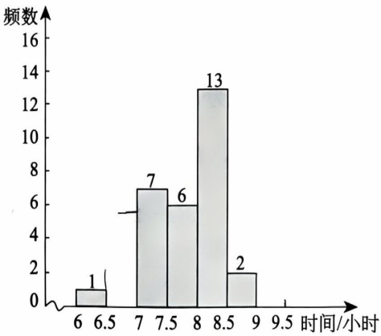

为了了解某校七年级学生的睡眠情况，小明等 5 名同学组成学习小组随机抽查了该校七年级 40 名学生一周（7天）平均每天的睡眠时间（单位：小时）如下：

| 8 | 6.8 | 6.5 | 7.2 | 7.1 | 7.5 | 7.7 | 9 | 8.3 | 8 |
|---|---|---|---|---|---|---|---|---|---|
| 8.3 | 9 | 8.5 | 8 | 8.4 | 8 | 7.3 | 7.5 | 7.3 | 9 |
| 8.3 | 6 | 7.5 | 7.5 | 9 | 6.5 | 6.6 | 8.4 | 8.2 | 8.1 |
| 7 | 7.8 | 8 | 9 | 7 | 9 | 8 | 6.6 | 7 | 8.5 |

该小组将上面收集到的数据进行了整理，绘制成频数分布表和频数分布直方图.

平均每天睡眠时间频数分布表

| 分组 | 频数 |
|---|---|
| 6 ≤ x&lt;6.5 | 1 |
| 6.5 ≤ x&lt;7 | m |
| 7 ≤ x&lt;7.5 | 7 |
| 7.5 ≤ x&lt;8 | 6 |
| 8 ≤ x&lt;8.5 | 13 |
| 8.5 ≤ x&lt;9 | 2 |
| 9 ≤ x&lt;9.5 | n |

平均每天睡眠时间频数分布直方图

根据以上信息，解答下列问题：

(1) 表中 $m=$ ___ ，$n=$ ___ ；

(2) 请补全频数分布直方图；

(3) 若该校七年级共有 $360$ 名学生，请你估算其中睡眠时间不少于 $9$ 小时的学生约有多少人.

> [!question]- 点击查看答案与解析
> **【答案】**(1) $m=4, n=3$；(2) 图略；(3) 约54人
> **【考点】** [[【初中数学知识点体系-人教版】#12-1 统计调查]]
> **【解析】**
> (1) 总数据40个
> $6 \leqslant x<6.5$：1个
> $6.5 \leqslant x<7$：4个（$m=4$）
> $7 \leqslant x<7.5$：7个
> $7.5 \leqslant x<8$：6个
> $8 \leqslant x<8.5$：13个
> $8.5 \leqslant x<9$：2个
> $9 \leqslant x<9.5$：3个（$n=3$）
> (2) 补全直方图略
> (3) 睡眠时间不少于9小时的比例：$\frac{3}{40}$
> $360 \times \frac{3}{40}=27$（人）
> **【易错点】**统计频数时出错，或用样本估计总体时计算错误。
