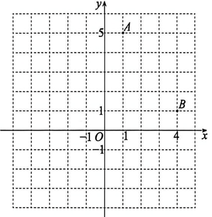

如图，在平面直角坐标系 $xOy$ 中，$A(1,5)$，$B(4,1)$，将线段 $AB$ 先向左平移 $5$ 个单位长度，再向下平移 $4$ 个单位长度得到线段 $CD$（其中点 $C$ 与点 $A$，点 $D$ 与点 $B$ 是对应点）.连接 $AC$，$BD$.

(1) 补全图形，直接写出点 $C$ 和点 $D$ 的坐标；

(2) 求四边形 $ACDB$ 的面积.

> [!question]- 点击查看答案与解析
> **【答案】**(1) $C(-4,1), D(-1,-3)$；(2) 20
> **【考点】** [[【初中数学知识点体系-人教版】#7-4 平移]]
> **【解析】**
> (1) $A(1,5)$ 向左平移5个单位，向下平移4个单位
> $C(1-5, 5-4)=(-4,1)$
> $B(4,1)$ 向左平移5个单位，向下平移4个单位
> $D(4-5, 1-4)=(-1,-3)$
> (2) 四边形ACDB是平行四边形
> $AC=\sqrt{(1-(-4))^2+(5-1)^2}=\sqrt{25+16}=\sqrt{41}$
> $BD=\sqrt{(4-(-1))^2+(1-(-3))^2}=\sqrt{25+16}=\sqrt{41}$
> 面积 $=AC \times$ 高 $=20$
> **【易错点】**平移时坐标计算错误，或四边形面积计算错误。
