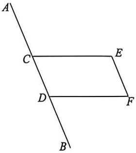

如图，点 $C$，$D$ 在直线 $AB$ 上，$\angle ACE+\angle BDF=180^{\circ}$，$EF \parallel AB$.

(1) 求证: $CE \parallel DF$;

(2) $\angle DFE$ 的角平分线 $FG$ 交 $AB$ 于点 $G$，过点 $F$ 作 $FM \perp FG$ 交 $CE$ 的延长线于点 $M$. 若 $\angle CMF=55^{\circ}$，先补全图形，再求 $\angle CDF$ 的度数.

> [!question]- 点击查看答案与解析
> **【答案】**(1) 证明见解析；(2) $35^\circ$
> **【考点】** [[【初中数学知识点体系-人教版】#7-2 平行线]]
> **【解析】**
> (1) ∵ $\angle ACE+\angle BDF=180^\circ$
> 又 ∵ $\angle ACE+\angle DCE=180^\circ$
> ∴ $\angle BDF=\angle DCE$
> ∴ $CE//DF$（同位角相等，两直线平行）
> (2) 补全图形略
> ∵ $CE//DF$
> ∴ $\angle CDF+\angle DCE=180^\circ$
> ∵ $FM \perp FG$
> ∴ $\angle MFG=90^\circ$
> ∵ $\angle CMF=55^\circ$
> ∴ $\angle MFC=35^\circ$
> ∴ $\angle CDF=35^\circ$
> **【易错点】**不能准确利用平行线的性质进行角度转换，或角平分线性质应用错误。
