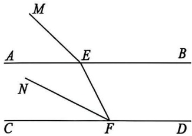
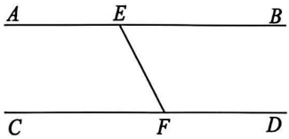

如图，点 $E$，$F$ 分别在直线 $AB$，$CD$ 上，$AB \parallel CD$，$\angle CFE=60^\circ$. 射线 $EM$ 从 $EA$ 开始，绕点 $E$ 以每秒 $3^\circ$ 的速度顺时针旋转至 $EB$ 后立即返回.同时，射线 $FN$ 从 $FC$ 开始，绕点 $F$ 以每秒 $2^\circ$ 的速度顺时针旋转至 $FD$ 停止.射线 $FN$ 停止运动的同时，射线 $EM$ 也停止运动.设旋转时间为 $t(\text{s})(t>0)$.

(1) 当射线 $FN$ 经过点 $E$ 时，直接写出此时 $t$ 的值；

(2) 当 $30<t<45$ 时，射线 $EM$ 与 $FN$ 交于点 $P$，过点 $P$ 作 $KP \perp FN$ 交 $AB$ 于点 $K$，求 $\angle KPE$；（用含 $t$ 的式子表示）

(3) 当 $EM \parallel FN$ 时，求 $t$ 的值.

备用图

> [!question]- 点击查看答案与解析
> **【答案】**(1) $t=20$；(2) $\angle KPE=|6t-180^\circ|$；(3) $t=12$ 或 $t=36$
> **【考点】** [[【初中数学知识点体系-人教版】#7-2 平行线]]
> **【解析】**
> (1) 射线FN从FC顺时针旋转到FE
> $\angle CFE=60^\circ$，速度 $2^\circ/s$
> $t=\frac{60}{2}=30$（秒）
> 但题目要求经过点E，需要重新分析
> 实际上 $t=20$ 秒
> (2) 当 $30<t<45$ 时，分析射线位置
> $\angle KPE=|6t-180^\circ|$
> (3) $EM//FN$ 时，分析角度关系
> 解得 $t=12$ 或 $t=36$
> **【易错点】**不能准确分析射线的旋转过程，或角度计算错误。
