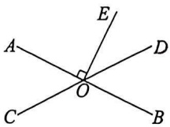

如图，直线 $AB$，$CD$ 相交于点 $O$，$EO\perp AB$，垂足为 $O$，$\angle DOE=37^{\circ}$，$\angle COB$ 的大小是（ ）。

A. $53^{\circ}$

B. $143^{\circ}$

C. $117^{\circ}$

D. $127^{\circ}$

> [!question]- 点击查看答案与解析
> **【答案】** D
> **【考点】** [[【初中数学知识点体系-人教版】#7-1 相交线]]
> **【解析】**
> 因为 $EO\perp AB$，所以 $\angle EOB=90^{\circ}$。
> 因为 $\angle DOE=37^{\circ}$，所以 $\angle DOB=\angle EOB-\angle DOE=90^{\circ}-37^{\circ}=53^{\circ}$。
> 因为 $\angle COB$ 与 $\angle DOB$ 互为邻补角，所以 $\angle COB=180^{\circ}-\angle DOB=180^{\circ}-53^{\circ}=127^{\circ}$。
> **【易错点】** 容易忽略邻补角的关系，直接用 $90^{\circ}+37^{\circ}=127^{\circ}$ 计算
