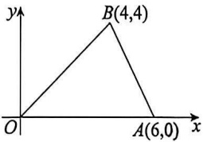
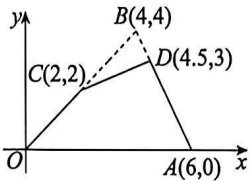
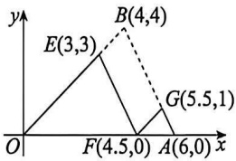

以某公园西门 $O$ 为原点建立平面直角坐标系，东门 $A$ 和景点 $B$ 的坐标分别是 $(6,0)$ 和 $(4,4)$。如图 $1$，甲的游览路线是：$O\to B\to A$，其折线段的路程总长记为 $l_1$。如图 $2$，景点 $C$ 和 $D$ 分别在线段 $OB$，$BA$ 上，乙的游览路线是：$O\to C\to D\to A$，其折线段的路程总长记为 $l_2$。如图 $3$，景点 $E$ 和 $G$ 分别在线段 $OB$，$BA$ 上，景点 $F$ 在线段 $OA$ 上，丙的游览路线是：$O\to E\to F\to G\to A$，其折线段的路程总长记为 $l_3$。下列 $l_1$，$l_2$，$l_3$ 的大小关系正确的是（ ）

图1 

图2 

图3 

A. $l_{1}=l_{2}=l_{3}$

B. $l_{1}<l_{2}$ 且 $l_{2}=l_{3}$

C. $l_{2}<l_{1}<l_{3}$

D. $l_{1}>l_{2}$ 且 $l_{1}=l_{3}$

> [!question]- 点击查看答案与解析
> **【答案】** A
> **【考点】** [[【初中数学知识点体系-人教版】#9-2 坐标方法的简单应用]]
> **【解析】**
> 由于每条折线段都是从 $O$ 到 $A$ 的路径，且坐标系的特性使得水平方向和竖直方向的距离是固定的。
> 对于甲的路线 $O\to B\to A$：$O(0,0)\to B(4,4)\to A(6,0)$，路程 $l_1=|OB|+|BA|$。
> 由于 $B(4,4)$，从 $O$ 到 $B$ 的水平距离为 $4$，竖直距离为 $4$；从 $B$ 到 $A$ 的水平距离为 $2$，竖直距离为 $4$。
> 根据"阶梯性质"，无论折线如何转折，只要起点和终点相同，且折线只包含水平和竖直方向的线段，总路程就等于水平距离加竖直距离。
> 三条路线的总水平距离都是 $6$，总竖直距离都是 $4+4=8$（先上后下），所以 $l_1=l_2=l_3$。
> **【易错点】** 容易误以为不同的折线路径长度不同，需要理解"阶梯性质"
