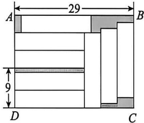

有 $8$ 张形状、大小完全相同的小长方形卡片，将它们按如图所示的方式（不重叠）放置在大长方形 $ABCD$ 中，根据图中标出的数据，$1$ 张小长方形卡片的面积是（ ）。

A. $72$

B. $68$

C. $64$

D. $60$

> [!question]- 点击查看答案与解析
> **【答案】** A
> **【考点】** [[【初中数学知识点体系-人教版】#10-3 实际问题与二元一次方程组]]
> **【解析】**
> 设小长方形卡片的长为 $l$，宽为 $w$。
> 根据图中标出的数据，大长方形 $ABCD$ 的长为 $18$，宽为 $12$。
> 从图中可以看出：$2$ 个小长方形竖放，宽度之和等于大长方形的宽，即 $2w=12$，所以 $w=6$。
> $1$ 个小长方形的长加上 $1$ 个小长方形的宽等于大长方形的长，即 $l+w=18$。
> 代入 $w=6$，得 $l+6=18$，$l=12$。
> 所以 $1$ 张小长方形卡片的面积 $=l\times w=12\times6=72$。
> **【易错点】** 需要仔细分析图形中小长方形的排列方式，正确列出方程组
