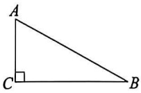

如图，在三角形 $ABC$ 中，$\angle C=90^{\circ}$，点 $B$ 到直线 $AC$ 的距离是线段 ___ 的长，$BC<BA$ 的依据是 ___ 。

> [!question]- 点击查看答案与解析
> **【答案】** $BC$；垂线段最短
> **【考点】** [[【初中数学知识点体系-人教版】#7-1 相交线]]
> **【解析】**
> 因为 $\angle C=90^{\circ}$，所以 $BC\perp AC$。
> 点 $B$ 到直线 $AC$ 的距离就是从点 $B$ 向直线 $AC$ 作垂线，垂足为 $C$，垂线段为 $BC$。
> 所以点 $B$ 到直线 $AC$ 的距离是线段 $BC$ 的长。
> $BC<BA$ 的依据是"垂线段最短"，即从直线外一点到这条直线的所有线段中，垂线段最短。
> **【易错点】** 容易混淆"点到直线的距离"与"点到点的距离"
