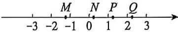

点 $M$，$N$，$P$，$Q$ 在数轴上的位置如图所示，这四个点中有一个点表示实数 $\sqrt{5}-1$，这个点是 ___ 。

> [!question]- 点击查看答案与解析
> **【答案】** 点 $P$
> **【考点】** [[【初中数学知识点体系-人教版】#8-3 实数及其简单运算]]
> **【解析】**
> $\sqrt{5}\approx2.236$，所以 $\sqrt{5}-1\approx1.236$。
> 根据数轴上点的位置，点 $M$，$N$，$P$，$Q$ 分别表示不同的实数。
> 通过估算，$\sqrt{5}-1\approx1.236$ 对应的是点 $P$。
> **【易错点】** 需要准确估算 $\sqrt{5}$ 的值
