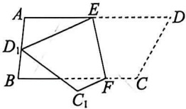

如图，四边形纸片 $ABCD$，$AD\parallel BC$。折叠纸片 $ABCD$，使点 $D$ 落在 $AB$ 上的点 $D_{1}$ 处，点 $C$ 落在点 $C_{1}$ 处，折痕为 $EF$。若 $\angle EFC=102^{\circ}$，则 $\angle AED_{1}=$ ___ 。

> [!question]- 点击查看答案与解析
> **【答案】** $24^{\circ}$
> **【考点】** [[【初中数学知识点体系-人教版】#7-2 平行线]]
> **【解析】**
> 因为 $AD\parallel BC$，所以 $\angle DEF+\angle EFC=180^{\circ}$（同旁内角互补）。
> 因为 $\angle EFC=102^{\circ}$，所以 $\angle DEF=180^{\circ}-102^{\circ}=78^{\circ}$。
> 折叠后，$\angle DFE=\angle D_1FE$。
> 因为 $\angle DFE=\angle DEF=78^{\circ}$（折叠性质），
> 所以 $\angle DFD_1=2\times78^{\circ}=156^{\circ}$。
> 因为 $\angle AED_1+\angle DFD_1=180^{\circ}$（平角），
> 所以 $\angle AED_1=180^{\circ}-156^{\circ}=24^{\circ}$。
> **【易错点】** 容易忽略折叠后角度相等的性质
