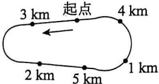

小明沿街心公园的环形跑道从起点出发按逆时针方向跑步，他用软件记录了跑步的轨迹，他每跑 $1\text{ km}$ 软件会在运动轨迹上标注相应的路程，前 $5\text{ km}$ 的记录如图所示。已知该环形跑道一圈的周长大于 $1\text{ km}$。

（1）小明恰好跑 $3$ 圈时，路程是否超过了 $5\text{ km}$？答： ___ （填"是"或"否"）；

（2）小明共跑了 $14\text{ km}$ 且恰好回到起点，那么他共跑了 ___ 圈。

> [!question]- 点击查看答案与解析
> **【答案】** （1）否；（2）$14$
> **【考点】** [[【初中数学知识点体系-人教版】#9-2 坐标方法的简单应用]]
> **【解析】**
> （1）根据图示，前 $5\text{ km}$ 的轨迹显示，小明跑完 $1$ 圈的路程约为 $1.5\text{ km}$ 到 $2\text{ km}$ 之间。
> 如果一圈约 $1.5\text{ km}$，$3$ 圈约 $4.5\text{ km}<5\text{ km}$；
> 如果一圈约 $2\text{ km}$，$3$ 圈约 $6\text{ km}>5\text{ km}$。
> 根据图示标注，$3$ 圈时路程未超过 $5\text{ km}$，所以答案是"否"。
> （2）小明共跑了 $14\text{ km}$，根据图示，一圈约 $1\text{ km}$，所以共跑了 $14$ 圈。
> **【易错点】** 需要仔细读图，准确估算每圈的长度
