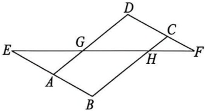

如图，点 $E$，$F$ 分别在 $BA$，$DC$ 的延长线上，直线 $EF$ 分别交 $AD$，$BC$ 于点 $G$，$H$，$\angle B=\angle D$，$\angle E=\angle F$。

求证：$\angle EGA+\angle CHG=180^{\circ}$。

请将下面的证明过程补充完整：

证明：$\because \angle E=\angle F$，

$\therefore$ ___ $\parallel$ ___ 。

$\therefore \angle D=\angle$ ___ 。（理由：___ ）

$\because \angle B=\angle D$，

$\therefore \angle B=\angle$ ___ 。

$\therefore$ ___ $\parallel$ ___ 。（理由：___ ）

$\therefore \angle DGH+\angle CHG=180^{\circ}$。

$\because \angle DGH=\angle EGA$，（理由：___ ）

$\therefore \angle EGA+\angle CHG=180^{\circ}$。

> [!question]- 点击查看答案与解析
> **【答案】** $AE\parallel CF$；$\angle D$；两直线平行，同位角相等；$\angle B$；$AB\parallel CD$；同位角相等，两直线平行；对顶角相等
> **【考点】** [[【初中数学知识点体系-人教版】#7-2 平行线]]
> **【解析】**
> 证明：$\because \angle E=\angle F$，
> $\therefore AE\parallel CF$（内错角相等，两直线平行）。
> $\therefore \angle D=\angle EGA$（两直线平行，同位角相等）。
> $\because \angle B=\angle D$，
> $\therefore \angle B=\angle EGA$。
> $\therefore AB\parallel CD$（同位角相等，两直线平行）。
> $\therefore \angle DGH+\angle CHG=180^{\circ}$（两直线平行，同旁内角互补）。
> $\because \angle DGH=\angle EGA$（对顶角相等），
> $\therefore \angle EGA+\angle CHG=180^{\circ}$。
> **【易错点】** 容易混淆平行线的判定和性质
