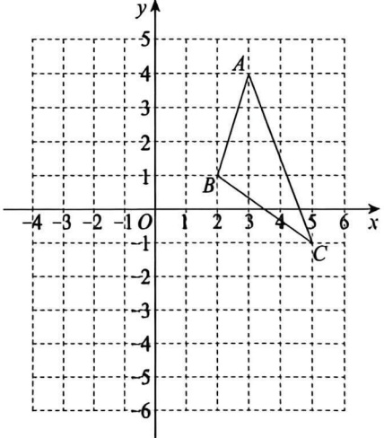

如图，在平面直角坐标系 $xOy$ 中，三角形 $ABC$ 三个顶点的坐标分别是 $A(3,4)$，$B(2,1)$，$C(5,-1)$。将三角形 $ABC$ 先向左平移 $5$ 个单位长度，再向下平移 $4$ 个单位长度后得到三角形 $DEF$，其中点 $D$，$E$，$F$ 分别为点 $A$，$B$，$C$ 的对应点。

（1）在图中画出三角形 $DEF$；

（2）求三角形 $ABC$ 的面积；

（3）若三角形 $ABC$ 内一点 $P$ 经过上述平移后的对应点为 $Q(m,n)$，直接写出点 $P$ 的坐标（用含 $m$，$n$ 的式子表示）。

> [!question]- 点击查看答案与解析
> **【答案】** （1）画图略；（2）$\frac{11}{2}$；（3）$P(m+5,n+4)$
> **【考点】** [[【初中数学知识点体系-人教版】#7-4 平移]]
> **【解析】**
> （1）将 $A(3,4)$，$B(2,1)$，$C(5,-1)$ 分别向左平移 $5$ 个单位，向下平移 $4$ 个单位：
> $D(3-5,4-4)=(-2,0)$
> $E(2-5,1-4)=(-3,-3)$
> $F(5-5,-1-4)=(0,-5)$
> 画出三角形 $DEF$。
> （2）三角形 $ABC$ 的面积可以用"割补法"计算。
> $A(3,4)$，$B(2,1)$，$C(5,-1)$。
> 面积 $=\frac{1}{2}|x_A(y_B-y_C)+x_B(y_C-y_A)+x_C(y_A-y_B)|$
> $=\frac{1}{2}|3(1-(-1))+2((-1)-4)+5(4-1)|$
> $=\frac{1}{2}|3\times2+2\times(-5)+5\times3|$
> $=\frac{1}{2}|6-10+15|$
> $=\frac{1}{2}\times11=\frac{11}{2}$
> （3）平移后 $Q(m,n)$，平移向量为 $(-5,-4)$。
> 所以 $P$ 的坐标为 $(m-(-5),n-(-4))=(m+5,n+4)$。
> **【易错点】** 容易搞错平移方向或面积计算
