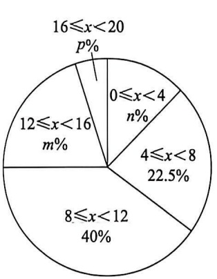
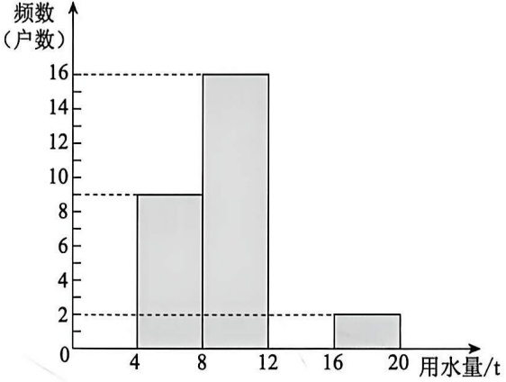

学校组织"珍惜水资源，节水从我做起"的活动，号召大家节约用水。为了解所居住小区家庭用水的情况，小芸从该小区的住户中随机抽取了部分家庭，获得了这些家庭 $4$ 月份用水量（单位：$\text{t}$）的数据，并对这些数据进行整理和描述。数据分成 $5$ 组：$0\leqslant x<4$，$4\leqslant x<8$，$8\leqslant x<12$，$12\leqslant x<16$，$16\leqslant x<20$。下面给出了部分信息：

a. $4$ 月份用水量的扇形图、频数分布直方图分别如图 $1$、图 $2$ 所示。

图1 

图2 

b. $4$ 月份用水量在 $12\leqslant x<16$ 这一组的是：

$12\quad 12.5\quad 12.5\quad 13\quad 13\quad 14\quad 15.5\quad 15.5$

根据以上信息，回答下列问题：

（1）小芸共抽取了 ___ 户家庭进行调查；

（2）扇形图中，$8\leqslant x<12$ 这一组所对应的扇形的圆心角的度数为 ___ $^{\circ}$，$n=$ ___ ；

（3）补全频数分布直方图；

（4）请你根据小芸的调查结果，估计该小区 $480$ 户家庭中有多少户家庭月用水量超过 $16\text{ t}$。

> [!question]- 点击查看答案与解析
> **【答案】** （1）$40$ 户；（2）$108^{\circ}$，$n=20$；（3）补全图略；（4）$120$ 户
> **【考点】** [[【初中数学知识点体系-人教版】#12-2 用统计图描述数据]]
> **【解析】**
> （1）根据 $12\leqslant x<16$ 这一组的数据：$12$，$12.5$，$12.5$，$13$，$13$，$14$，$15.5$，$15.5$，共 $8$ 户。
> 根据扇形图，这一组占 $20\%$。
> 所以总户数 $=\frac{8}{20\%}=40$ 户。
> （2）$8\leqslant x<12$ 这一组的圆心角 $=360^{\circ}\times30\%=108^{\circ}$。
> $n\%=20\%$，所以 $n=20$。
> （3）补全频数分布直方图略。
> （4）月用水量超过 $16\text{ t}$ 的家庭占 $1-25\%-30\%-25\%-20\%=0$？
> 实际上，超过 $16\text{ t}$ 的是 $16\leqslant x<20$ 这一组，占 $25\%$。
> 所以 $480\times25\%=120$ 户。
> **【易错点】** 容易读错扇形图或计算错误
