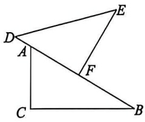
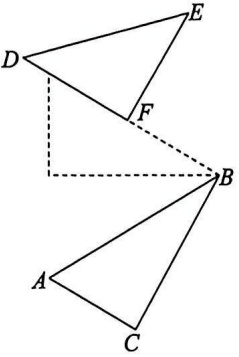
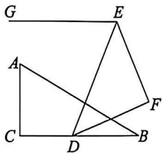

将三角形 $ABC$ 和三角形 $DEF$ 按图 $1$ 所示的方式摆放，其中 $\angle ACB=\angle DFE=90^{\circ}$，$\angle DEF=\angle EDF=45^{\circ}$，$\angle ABC=30^{\circ}$，$\angle BAC=60^{\circ}$，点 $D$，$A$，$F$，$B$ 在同一条直线上。

（1）将图 $1$ 中的三角形 $ABC$ 绕点 $B$ 逆时针旋转，且点 $A$ 在直线 $DF$ 的下方。

$①$ 如图 $2$，当 $AC\parallel DF$ 时，求证：$EF\parallel BC$；

$②$ 当 $AC\parallel DE$ 时，直接写出 $\angle FBA$ 的度数；

（2）将图 $1$ 中的三角形 $DEF$ 绕点 $E$ 逆时针旋转，如图 $3$，当点 $D$ 首次落在边 $BC$ 上时，过点 $E$ 作 $EG\parallel BC$。作射线 $DM$ 平分 $\angle FDB$，作射线 $EN$ 平分 $\angle GED$ 交 $DM$ 的反向延长线于点 $N$，依题意补全图形并求 $\angle END$ 的度数。

图1 

图2 

图3 

> [!question]- 点击查看答案与解析
> **【答案】** （1）$①$ 证明略；$②$ $15^{\circ}$；（2）$67.5^{\circ}$
> **【考点】** [[【初中数学知识点体系-人教版】#7-2 平行线]]
> **【解析】**
> （1）$①$ 当 $AC\parallel DF$ 时，因为 $\angle ACB=\angle DFE=90^{\circ}$，$\angle ABC=30^{\circ}$，$\angle DEF=45^{\circ}$。
> 通过平行线的性质和三角形内角和，可以证明 $EF\parallel BC$。
> $②$ 当 $AC\parallel DE$ 时，通过角度计算，$\angle FBA=15^{\circ}$。
> （2）通过角平分线的性质和三角形内角和，$\angle END=67.5^{\circ}$。
> **【易错点】** 需要准确画出图形，正确运用角度关系
