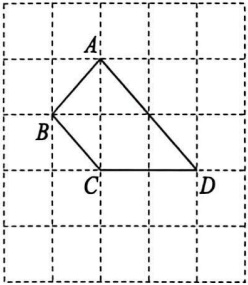
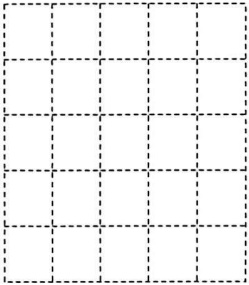

在边长为 $1$ 的正方形网格中，网格线交点称为格点，顶点都在格点上的多边形称为格点多边形。将格点多边形边上（含顶点）的格点个数记为 $M$，内部的格点个数记为 $N$，其面积记为 $S$，它们满足公式 $S=aM+N+b$。小东忘记了公式中 $a$，$b$ 的值，他想到可以借助两个特殊格点多边形求出 $a$，$b$ 的值。小东画出一个格点四边形 $ABCD$（如图 $1$），它所对应的 $M=6$，$N=1$，$S=3$。

（1）请在图 $2$ 中画出一个格点三角形 $EFG$，并直接写出它所对应的 $M$，$N$，$S$ 的值；

（2）求 $a$，$b$ 的值。

图1 

图2 

> [!question]- 点击查看答案与解析
> **【答案】** （1）画图略，$M=4$，$N=0$，$S=1$（答案不唯一）；（2）$a=\frac{1}{2}$，$b=-1$
> **【考点】** [[【初中数学知识点体系-人教版】#7-4 平移]]
> **【解析】**
> （1）画一个格点三角形，例如顶点为 $(0,0)$，$(2,0)$，$(0,2)$。
> 边上格点数 $M=4$（包括顶点），内部格点数 $N=0$，面积 $S=\frac{1}{2}\times2\times2=2$。
> 或者画更小的三角形，$M=3$，$N=0$，$S=\frac{1}{2}$。
> （2）根据四边形 $ABCD$：$M=6$，$N=1$，$S=3$。
> 代入公式 $S=aM+N+b$：$3=6a+1+b$，即 $6a+b=2\cdots①$。
> 再取一个特殊图形，例如 $M=3$，$N=0$，$S=\frac{1}{2}$（最小三角形）。
> 代入：$\frac{1}{2}=3a+0+b$，即 $3a+b=\frac{1}{2}\cdots②$。
> $①-②$：$3a=\frac{3}{2}$，$a=\frac{1}{2}$。
> 将 $a=\frac{1}{2}$ 代入 $②$：$\frac{3}{2}+b=\frac{1}{2}$，$b=-1$。
> 所以 $a=\frac{1}{2}$，$b=-1$。
> **【易错点】** 需要正确数出格点数和计算面积
