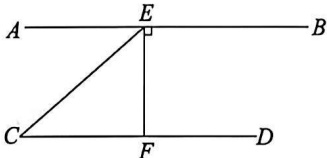

如图，$AB // CD$，点 $E$ 在 $AB$ 上，过点 $E$ 作 $AB$ 的垂线交 $CD$ 于点 $F$。若 $\angle ECD = 40^{\circ}$，则 $\angle CEF$ 的大小为（ ）。

A. $40^{\circ}$

B. $50^{\circ}$

C. $60^{\circ}$

D. $70^{\circ}$

> [!question]- 点击查看答案与解析
> **【答案】** B
> **【考点】** [[【初中数学知识点体系-人教版】#7-2 平行线]]
> **【解析】**
> - 因为 $EF \perp AB$，所以 $\angle BEF = 90^\circ$
> - 因为 $AB \parallel CD$，所以 $\angle EFC = \angle BEF = 90^\circ$（内错角相等）
> - 因为 $\angle ECD = 40^\circ$，在三角形 $EFC$ 中，$\angle CEF = 180^\circ - 90^\circ - 40^\circ = 50^\circ$
> **【易错点】** 不能准确利用平行线的性质进行角度转换，或忽略垂直条件。
