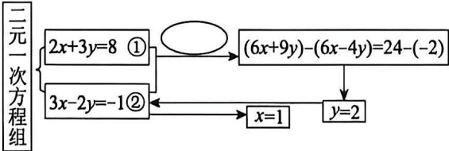

解方程组 $\left\{\begin{array}{l}2x+3y=8,\\3x-2y=-1\end{array}\right.$ 的思路可用如图的框图表示，圈中应填写的对方程 $①$ 和 $②$ 所做的变形为（）。

A. $①\times2+②\times3$

B. $①\times2-②\times3$

C. $①\times3-②\times2$

D. $①\times3+②\times2$

> [!question]- 点击查看答案与解析
> **【答案】** A
> **【考点】** [[【初中数学知识点体系-人教版】#10-2 消元——解二元一次方程组]]
> **【解析】**
> - 方程组 $\left\{\begin{array}{l}2x+3y=8 \quad ①\\3x-2y=-1 \quad ②\end{array}\right.$
> - 要消去 $y$，需要使 $y$ 的系数互为相反数
> - $① \times 2$ 得 $4x+6y=16$
> - $② \times 3$ 得 $9x-6y=-3$
> - 两式相加得 $13x=13$，消去了 $y$
> - 因此变形为 $① \times 2 + ② \times 3$
> **【易错点】** 不能准确判断消元时需要乘以的系数，或混淆加法与减法的使用场景。
