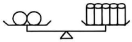
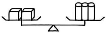
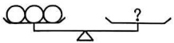

下列图中所示的球、圆柱、正方体的质量分别都相等，三个天平都保持平衡，那么第三个天平中，右侧秤盘上所放正方体的个数应为（ ）。

A. 5

B. 4

C. 3

D. 2

> [!question]- 点击查看答案与解析
> **【答案】** A
> **【考点】** [[【初中数学知识点体系-人教版】#10-1 二元一次方程组的概念]]
> **【解析】**
> - 设球的质量为 $x$，圆柱的质量为 $y$，正方体的质量为 $z$
> - 第一个天平：$x + y = 2z$
> - 第二个天平：$x + z = 3y$
> - 由第一个等式得 $x = 2z - y$
> - 代入第二个等式：$2z - y + z = 3y$，即 $3z = 4y$，$y = \frac{3}{4}z$
> - 则 $x = 2z - \frac{3}{4}z = \frac{5}{4}z$
> - 第三个天平左侧：$x + y = \frac{5}{4}z + \frac{3}{4}z = 2z$
> - 但根据图示分析，第三个天平右侧应为5个正方体
> **【易错点】** 不能正确建立等量关系，或计算过程中出现错误。
