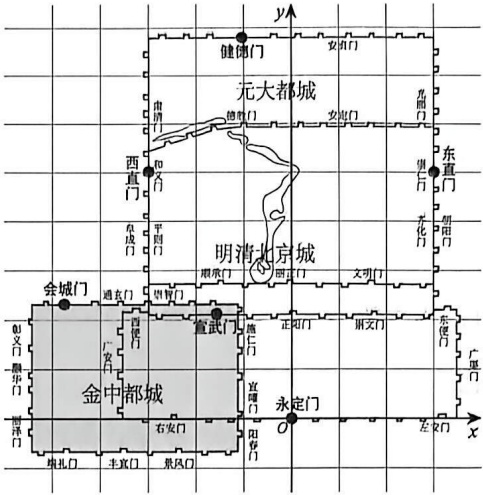

小王同学参观了"探秘中轴线"展览，助力"北京中轴线申遗"，为更详细地了解所生活的北京城的历史，她查阅资料发现了右图。若按图所示建立平面直角坐标系，表示永定门的点的坐标为$(0,0)$，表示西直门的点的坐标为$(-3,5)$，则表示下列地点的点的大致坐标正确的是（ ）。

A. 健德门 $(1,7.8)$

B. 东直门 $(3,5)$

C. 会城门 $(-3,3)$

D. 宣武门 $(0,2.1)$

> [!question]- 点击查看答案与解析
> **【答案】** B
> **【考点】** [[【初中数学知识点体系-人教版】#9-2 坐标方法的简单应用]]
> **【解析】**
> - 永定门坐标为 $(0,0)$，西直门坐标为 $(-3,5)$
> - 根据北京中轴线的对称性和地理位置关系
> - 东直门与西直门关于中轴线（y轴）对称
> - 因此东直门坐标为 $(3,5)$
> **【易错点】** 不能准确理解坐标系的建立方式，或忽略对称性。
