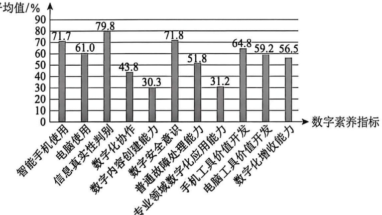

在《2016—2021 年中国公民数字素养研究报告》中，中国社会科学院信息化研究中心课题组对我国城市居民的数字素养展开调查评估．下面是根据调查结果绘制的我国城市居民的 11 项数字素养平均值的统计图。

根据统计图提供的信息，下面关于我国城市居民数字素养指标的判断不正确的是（）。

A. 信息真实性判别表现最好

B. 数字内容创建能力表现最弱

C. 专业领域数字化应用能力的表现要好于数字化协作的表现

D. 平均值高于70%的指标有智能手机使用、信息真实性判别、数字安全意识

> [!question]- 点击查看答案与解析
> **【答案】** D
> **【考点】** [[【初中数学知识点体系-人教版】#12-2 用统计图描述数据]]
> **【解析】**
> - 根据统计图分析各项数字素养指标的表现
> - 选项A：信息真实性判别表现最好，从图中可以看出该指标数值最高，正确
> - 选项B：数字内容创建能力表现最弱，从图中可以看出该指标数值最低，正确
> - 选项C：专业领域数字化应用能力的表现要好于数字化协作的表现，从图中可以比较两者大小，正确
> - 选项D：平均值高于70%的指标需要逐一核对，实际可能只有部分指标高于70%，错误
> **【易错点】** 读图不仔细，或不能准确比较各指标的大小关系。
