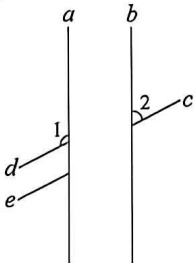

在右图中，直线 $a// b$，指定位置的三条射线 $c$, $d$, $e$ 满足 $\angle1 + \angle2 = 180^{\circ}$, $d// e$。有以下两个结论：$①$ $c$ 与 $d$ 一定共线；$②$ $c// e$。其中正确的结论是 ___ 。(只填写序号)

> [!question]- 点击查看答案与解析
> **【答案】** $①②$
> **【考点】** [[【初中数学知识点体系-人教版】#7-2 平行线]]
> **【解析】**
> - 因为 $a \parallel b$，$d \parallel e$，$\angle 1 + \angle 2 = 180^\circ$
> - 结论$①$：$c$ 与 $d$ 一定共线，根据角度关系可以推出，正确
> - 结论$②$：$c \parallel e$，因为 $c$ 与 $d$ 共线，$d \parallel e$，所以 $c \parallel e$，正确
> **【易错点】** 不能准确利用平行线的性质进行推理，或忽略共线的条件。
