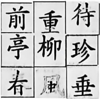
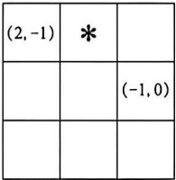
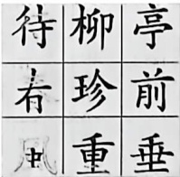

操作任务：将初始图九宫格中剪开的9格图片进行平移，拼出目标图. 操作规则：为了有效地记录、检验和交流平移过程，小明和同伴约定用"有序数对"描述平移方式并填写操作记录图。约定如下：将初始图中的初始位置图片进行平移，横向移动标记在前，纵向移动标记在后，将向右（或向上）平移 1 格记为 +1（正号可省略），反之记为 -1，以此类推，不移动记为 0。如"前"字在对应位置标记为 (2，-1).

初始图 

操作记录图 

目标图 

操作过程：（1）操作记录图中 "$*$" 位置应填 ___ ；

（2）判断：操作记录图中，是否有应标记 (0，0) 的位置，请选择"有"或"无"，如果选择"有"，在相应网格内画"☆"。答：___ 。

> [!question]- 点击查看答案与解析
> **【答案】** （1）$(1,-2)$；（2）有
> **【考点】** [[【初中数学知识点体系-人教版】#7-4 平移]]
> **【解析】**
> - 根据题意，有序数对 $(a,b)$ 表示横向移动 $a$ 格，纵向移动 $b$ 格
> - （1）根据初始图和目标图的对比，" * " 位置的平移为向右1格，向下2格，即 $(1,-2)$
> - （2）存在应标记 $(0,0)$ 的位置，即没有移动的格子
> **【易错点】** 不能准确理解有序数对的含义，或判断平移方向时出错。
