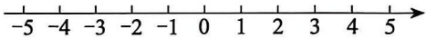

解不等式组 $\left\{\begin{array}{l}5x-2>3(x-1),\\\frac{1}{2}x-1\leqslant3-\frac{3}{2}x,\end{array}\right.$ 在数轴上表示出它的解集，并求它的整数解。

> [!question]- 点击查看答案与解析
> **【答案】** $-1 < x \leqslant 2$，整数解为 $0, 1, 2$
> **【考点】** [[【初中数学知识点体系-人教版】#11-3 一元一次不等式组]]
> **【解析】**
> 解不等式 $①$：$5x-2 > 3(x-1)$
> $5x-2 > 3x-3$
> $2x > -1$
> $x > -\frac{1}{2}$
> 解不等式 $②$：$\frac{1}{2}x-1 \leqslant 3-\frac{3}{2}x$
> $2x \leqslant 4$
> $x \leqslant 2$
> 不等式组的解集为 $-\frac{1}{2} < x \leqslant 2$
> 整数解为 $0, 1, 2$
> **【易错点】** 去分母时漏乘，或移项时符号错误。
