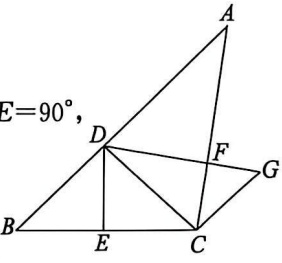

如图，在三角形 ABC 中，点 $D$ 在 AB 边上，$\angle BCD = \angle A$。点 $E$，F 分别在 BC，AC 边上，$\angle A + \angle ADF = 90^\circ$，$\angle BCD + \angle CDE = 90^\circ$，DF 的延长线上一点 $G$ 满足 $\angle G = \angle CDE$。

(1) 求证：$CG // AB$.

请将下面的证明过程补充完整：

证明：$\because \angle BCD+\angle CDE=90^{\circ}$

$\angle BCD = \angle A,$

$\therefore \angle ADF = \angle$ ___ . (理由：___ )

$\because \angle G = \angle CDE$,

∴$\angle$___=$\angle$___．（理由：___ ）

∴CG∥AB.（理由：___ ）

(2) 图中与 $\angle DCG$ 相等的角是 ___ 。

> [!question]- 点击查看答案与解析
> **【答案】** （1）证明见解析；（2）$\angle BCD$
> **【考点】** [[【初中数学知识点体系-人教版】#7-2 平行线]]
> **【解析】**
> （1）证明：因为 $\angle BCD+\angle CDE=90^\circ$，$\angle BCD=\angle A$
> 所以 $\angle A+\angle CDE=90^\circ$
> 又因为 $\angle A+\angle ADF=90^\circ$
> 所以 $\angle ADF=\angle CDE$（同角的余角相等）
> 因为 $\angle G=\angle CDE$
> 所以 $\angle G=\angle ADF$
> 所以 $CG \parallel AB$（同位角相等，两直线平行）
> （2）图中与 $\angle DCG$ 相等的角是 $\angle BCD$
> **【易错点】** 不能准确识别角的位置关系，或混淆平行线的判定与性质。
