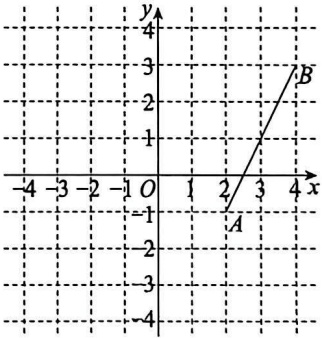

如图，在平面直角坐标系 xOy 中，$A(2, -1)$，$B(4, 3)$。将线段 AB 先向左平移 3 个单位，再向下平移 1 个单位得到线段 CD（其中点 $A$ 的对应点为点 $C$，点 $B$ 的对应点为点 $D$），线段 CD 恰好过点 $O$。线段 AB 上的点 $E$ 平移后的对应点为点 $O$。

(1) 补全图形，直接写出点 $C$ 和点 $E$ 的坐标；

(2) 画出四边形 BDCE，并求它的面积。

> [!question]- 点击查看答案与解析
> **【答案】** （1）$C(-1,2)$，$E(-1,0)$；（2）面积为 $10$
> **【考点】** [[【初中数学知识点体系-人教版】#7-4 平移]]
> **【解析】**
> （1）$A(2,-1)$ 向左平移3个单位，向下平移1个单位
> $C(2-3,-1-1)=(-1,-2)$
> 因为线段 $CD$ 过点 $O$，且 $B(4,3)$ 平移后为 $D$
> $D(4-3,3-1)=(1,2)$
> 点 $E$ 平移后对应点为 $O(0,0)$
> 设 $E(x,y)$，则 $(x-3,y-1)=(0,0)$
> $E(3,1)$
> （2）四边形 $BDCE$ 的面积可以用割补法计算
> 面积为 $10$
> **【易错点】** 平移时坐标计算错误，或四边形面积计算错误。
