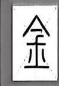
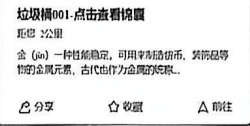
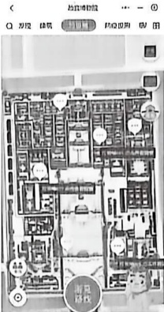
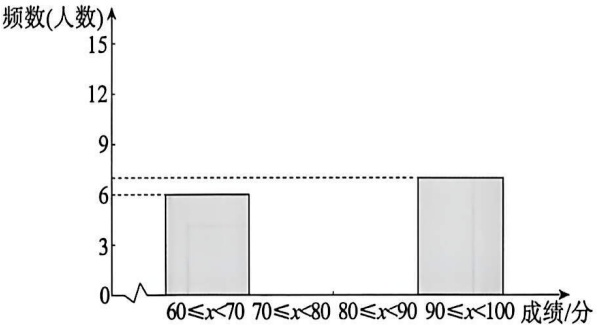

故宫博物院为鼓励游客参与"故宫零废弃"项目，做好垃圾分类，在"故宫博物院"小程序中推出了一项体验活动，将故宫改造升级后的垃圾桶编号并精心布局，在每个垃圾桶点位（共79个）设置一道与院内场景相关的篆体古字题目，游客点击相应点位的垃圾桶编号解答题目，以形会意，看字识"物"，并在感受中国传统文化的同时，了解垃圾分类知识。王老师在全年级随机邀请了 40 名学生在线参与答题，小明所在小组收集、整理同学们看字识"物"和辨别垃圾的答题成绩并制作统计图表（成绩为百分制）。下面是这 40 名学生成绩的频数分布表、频数分布直方图（数据分成4组：$60 \leq x < 70$，$70 \leq x < 80$，$80 \leq x < 90$，$90 \leq x < 100$），以及部分数据信息。

看字识"物"，替古人辨别垃圾，这是什么垃圾？答题赢取零废弃文创

金（Jin）一种性能稳定，可用来制造货币、装饰品等物的金属元素，古代也作为金属的统称。金属可以反复锻造，属于可回收物。请进行零废弃游览，做好垃圾分类。

a. 成绩频数分布表 

| 成绩 | 频数 |
|---|---|
| 60 ≤ x&lt;70 |  |
| 70 ≤ x&lt;80 | 12 |
| 80 ≤ x&lt;90 |  |
| 90 ≤ x&lt;100 |  |

b. 成绩频数分布直方图 

c. $80 \leq x < 90$ 这一组的成绩是：

| 80  | 80  | 80  | 80  | 81  | 81  | 81  | 83  | 83  | 83  | 84  | 84  | 84  | 85  | 87  |
| --- | --- | --- | --- | --- | --- | --- | --- | --- | --- | --- | --- | --- | --- | --- |

根据以上信息，回答下列问题：

（1）请补全成绩频数分布表和成绩频数分布直方图；

（2）$①$ 直接写出这 40 名学生中，成绩不低于85分的人数；

$②$ 若小明所在年级的 200 名学生参与此项活动，估计这 200 名学生中有多少人成绩不低于 85 分。

> [!question]- 点击查看答案与解析
> **【答案】** （1）频数分布表略；（2）$①$ $15$ 人；$②$ $75$ 人
> **【考点】** [[【初中数学知识点体系-人教版】#12-1 统计调查]]
> **【解析】**
> （1）根据 $80 \leq x < 90$ 这一组的数据和总人数 $40$，可以补全频数分布表
> $60 \leq x < 70$：$4$ 人
> $70 \leq x < 80$：$12$ 人
> $80 \leq x < 90$：$15$ 人
> $90 \leq x < 100$：$9$ 人
> （2）$①$ 成绩不低于 $85$ 分的人数：$85$ 分以上的有 $7$ 人（$80 \leq x < 90$ 组）$+ 9$ 人（$90 \leq x < 100$ 组）$= 15$ 人
> $②$ $200 \times \frac{15}{40} = 75$（人）
> **【易错点】** 统计频数时出错，或用样本估计总体时计算错误。
