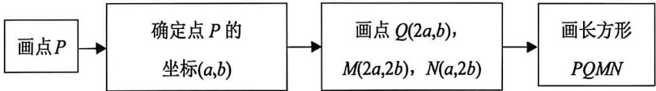
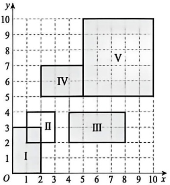
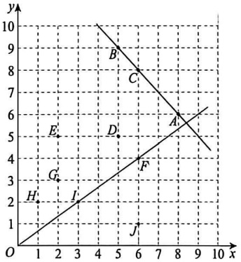

小明设计了如下一个小程序，用户运行此程序时，先在第一象限内任取一个点 $P$，程序就会在该点的右上方按逆时针方向画一个长方形 PQMN（包含可能出现正方形的情况），且水平边 PQ 的长等于这一点的横坐标，竖直边 PN 的长等于这一点的纵坐标，称此长方形为"程序长方形".

（1）图1所示的五个长方形，记为图形Ⅰ，Ⅱ，Ⅲ，Ⅳ，V，其中程序长方形是 ___ ，程序长方形最初所取点P的坐标为 ___ ；

（2）如图2，小明在第一象限画了 10 个整点（即横、纵坐标都为整数的点）A，B，C，⋯，J，程序相应地可画出 10 个长方形。

实验探究：

$①$ 在射线 OF$ 上任取一点（不同于点 $O$），则该点所对应的程序长方形的水平边与竖直边的长度之比等于___ ；

$②$ 在直线 AB$ 位于第一象限的部分上任意取几个点，写出这些点所对应的程序长方形的一个共同特征；

$③$ 记点 $I$ 所对应的程序长方形的面积为 s. 若要画一个 $\underset{\cdot}{整}\underset{\cdot}{点}$K，使它对应的程序长方形的面积小于 s 且周长尽可能大，直接写出点 $K$ 的坐标。

图1 

图2 

> [!question]- 点击查看答案与解析
> **【答案】** （1）Ⅱ、Ⅳ；$(2,3)$；（2）$①$ $1:1$；$②$ 程序长方形的周长相等；$③$ $K(1,1)$
> **【考点】** [[【初中数学知识点体系-人教版】#9-2 坐标方法的简单应用]]
> **【解析】**
> （1）根据"程序长方形"的定义，水平边 $PQ$ 的长等于点 $P$ 的横坐标，竖直边 $PN$ 的长等于点 $P$ 的纵坐标
> 图形Ⅱ、Ⅳ符合定义
> 点 $P$ 的坐标为 $(2,3)$
> （2）$①$ 射线 $OF$ 上的点满足 $y=x$，所以横坐标等于纵坐标，程序长方形的水平边与竖直边的长度之比为 $1:1$
> $②$ 直线 $AB$ 位于第一象限的部分上的点满足某种线性关系，程序长方形的周长相等
> $③$ 点 $I$ 对应的程序长方形面积为 $s$，要使点 $K$ 对应的程序长方形面积小于 $s$ 且周长尽可能大，点 $K$ 的坐标为 $(1,1)$
> **【易错点】** 不能准确理解新定义的含义，或分析图形特征时出错。
