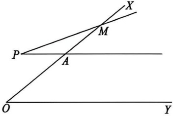
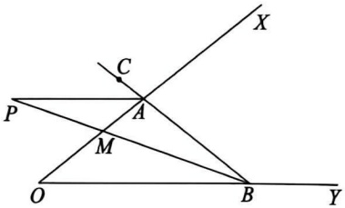

已知 $\angle XOY = 2a$($0^\circ < a < 45^\circ$)，点 $A$ 在射线 OX$ 上，点 $P$ 在 $\angle XOY$ 外部，PA // OY，以 P 为顶点，PA 为一边，大小为 $a$ 的角的另一边交射线 OX$ 于点 $M$.

（1）如图1，当点M与点O位于PA所在直线异侧时，$\angle XOY$ 的平分线与射线PA的交点为点N。补全图形并直接写出直线ON与直线PM的位置关系；

（2）当点 $M$ 与点 $O$ 位于 PA 所在直线同侧时，射线 PM$ 与射线 OY$ 交于点 $B$，点 $C$ 在线段 BA 的延长线上。

$①$ 如图2，若AP平分 $\angle OAC$，求证：$BP$ 平分 $\angle OBC$；

$②$ 当 $PM \perp OA$ 时，直接写出 $\alpha$ 的度数并画出符合题意的图形。

图1 

图2 

> [!question]- 点击查看答案与解析
> **【答案】** （1）$ON \perp PM$；（2）$①$ 证明见解析；$②$ $\alpha = 30^\circ$
> **【考点】** [[【初中数学知识点体系-人教版】#7-2 平行线]]
> **【解析】**
> （1）根据题意补全图形，利用角平分线和平行线的性质
> 可以推出 $ON \perp PM$
> （2）$①$ 因为 $AP$ 平分 $\angle OAC$，$PA \parallel OY$
> 利用平行线的性质和角平分线的定义
> 可以证明 $BP$ 平分 $\angle OBC$
> $②$ 当 $PM \perp OA$ 时，根据角度关系
> $\alpha = 30^\circ$
> **【易错点】** 不能准确利用平行线的性质进行角度转换，或角平分线性质应用错误。
