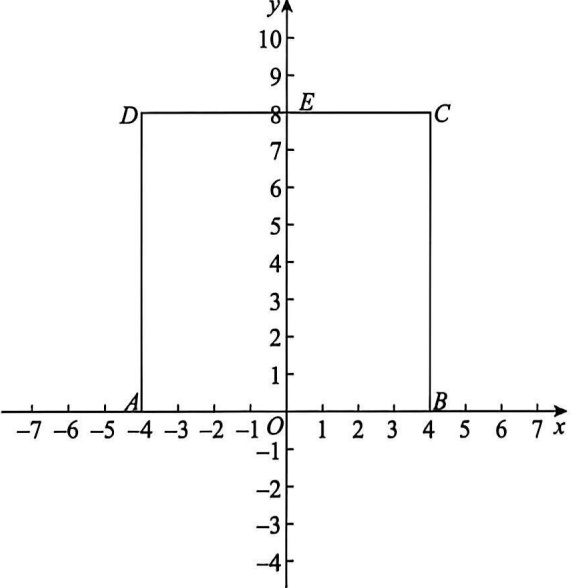

在平面直角坐标系 xOy 中，对于点 $A_{1}$，$A_{2}$，…，$A_{k}$，若这 k 个点的横坐标的最大值为 m，纵坐标的最大值为 n，将 $m+n$ 记为 $T\langle A_{1}, A_{2}, \cdots, A_{k} \rangle$，称为这 k 个点的"平面特征值"。如对于 $M(1,2)$，$N(1,3)$，$T\langle M, N \rangle = 1 + 3 = 4$。

如图，$A(-4,0)$，$B(4,0)$，正方形 ABCD 的边 AB 在 x 轴上，边 CD 与 y 轴正半轴的交点为点 $E$.

(1) $T \langle A, D, E \rangle = \underline{\qquad};$

(2) 已知 $F(0, b)$，过点 $F$ 作直线 $l \perp y$ 轴，直线 $l$ 与直线 $AC$ 交于点 $P$，直线 $l$ 与直线 $BD$ 交于点 $Q$。记 $T \langle A, B, P, Q \rangle = s$。

$①$ 当 b=6 时，s= ___ ；

$②$ 用含 b 的式子表示 s，判断当点 $F$ 在 y 轴上运动时，s 是否存在最大值或最小值，如果存在，写出 s 的值以及相应点 $F$ 的坐标。

> [!question]- 点击查看答案与解析
> 【答案】（1）$8$；（2）$①$ $10$；$②$ $s=|b|+4$，当 $b=0$ 时，$s$ 有最小值 $4$，此时 $F(0,0)$
> 
> 【考点】坐标方法的简单应用 → [[【初中数学知识点体系-人教版】#9-2 坐标方法的简单应用]]
> 
> 【解析】
> （1）$A(-4,0)$，$D(-4,4)$，$E(0,4)$
> 横坐标最大值 $m=0$，纵坐标最大值 $n=4$
> $T\langle A,D,E \rangle = 0+4 = 4$
> （2）$①$ 当 $b=6$ 时，$F(0,6)$
> 根据直线 $AC$ 和 $BD$ 的方程，求出 $P$、$Q$ 的坐标
> 计算得 $s=10$
> $②$ 根据 $F$ 的位置，用含 $b$ 的式子表示 $s$
> $s=|b|+4$
> 当 $b=0$ 时，$s$ 有最小值 $4$，此时 $F(0,0)$
> 
> 【易错点】不能准确理解新定义的含义，或计算坐标时出错。
