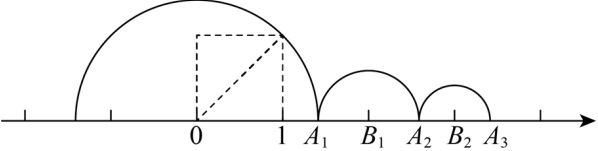

9. （24-25 七年级上·浙江温州·期末）如图，通过画边长为 1 的正方形，就能准确的把 $\sqrt{2}$ 表示在数轴上点 $A_1$ 处，记 $A_1$ 右侧最近的整数点为 $B_1$，以点 $B_1$ 为圆心，$A_1B_1$ 为半径画半圆，交数轴于点 $A_2$，记 $A_2$ 右侧最近的整数点为 $B_2$，以点 $B_2$ 为圆心，$A_2B_2$ 为半径画半圆，交数轴于点 $A_3$，如此继续，则 $A_8B_8$ 的长为（ ）

A. $\sqrt{2}-1$

B. $\sqrt{2}$

C. $\sqrt{2}+1$

D. $2-\sqrt{2}$

> [!question]- 点击查看答案与解析
> 【答案】A
> 
> 【考点】实数与数轴、规律探究 → [[【初中数学知识点体系-人教版】#8-3 实数及其简单运算]]
> 
> 【解析】
> 由题意：
> 
> $A_1 = \sqrt{2} \approx 1.414$，$B_1 = 2$（$A_1$ 右侧最近的整数点）
> 
> $A_1B_1 = 2-\sqrt{2}$
> 
> 以 $B_1$ 为圆心，$A_1B_1$ 为半径画半圆，交数轴于 $A_2$：
> 
> $A_2 = 2 + (2-\sqrt{2}) = 4-\sqrt{2} \approx 2.586$
> 
> $B_2 = 3$（$A_2$ 右侧最近的整数点）
> 
> $A_2B_2 = 3-(4-\sqrt{2}) = \sqrt{2}-1$
> 
> 以 $B_2$ 为圆心，$A_2B_2$ 为半径画半圆，交数轴于 $A_3$：
> 
> $A_3 = 3 + (\sqrt{2}-1) = 2+\sqrt{2} \approx 3.414$
> 
> $B_3 = 4$
> 
> $A_3B_3 = 4-(2+\sqrt{2}) = 2-\sqrt{2}$
> 
> **规律**：奇数项为 $2-\sqrt{2}$，偶数项为 $\sqrt{2}-1$。
> 
> $A_8B_8$ 是第8项（偶数），$= \sqrt{2}-1$。
> 
> 【易错点】找不出交替变化的规律；计算过程中出错。
