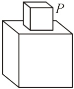

17. （24-25 七年级上·浙江温州·期中）现有两个大小不等的正方体积木玩具，大正方体积木体积为1000cm³，小正方体积木的体积为64cm³，将二者如图叠放于桌面上，则积木顶端P点到桌面的距离是 ___ cm。

> [!question]- 点击查看答案与解析
> 【答案】14
> 
> 【考点】立方根的实际应用 → [[【初中数学知识点体系-人教版】#8-2 立方根]]
> 
> 【解析】
> 大正方体的棱长 $= \sqrt[3]{1000} = 10$ cm
> 
> 小正方体的棱长 $= \sqrt[3]{64} = 4$ cm
> 
> 叠放后顶端P点到桌面的距离 = 大正方体棱长 + 小正方体棱长
> 
> $= 10 + 4 = 14$ cm
> 
> 【易错点】混淆面积和体积的开方运算；误以为是求表面积。
