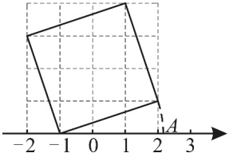

18. （24-25 八年级上·四川成都·阶段练习）如图，组成正方形网格的小正方形边长为 1，数轴上点 A 表示的数为 ___

> [!question]- 点击查看答案与解析
> 【答案】$\sqrt{5}$
> 
> 【考点】实数与数轴、勾股定理 → [[【初中数学知识点体系-人教版】#8-3 实数及其简单运算]]
> 
> 【解析】
> 由网格可知，倾斜正方形的边长可由勾股定理求得：
> 
> 边长 $= \sqrt{1^2+2^2} = \sqrt{1+4} = \sqrt{5}$
> 
> 以原点为圆心，边长为半径画弧交数轴正半轴于点A，
> 
> 所以点A表示的数为 $\sqrt{5}$。
> 
> 【易错点】勾股定理应用错误；半径与圆心位置判断错误。
