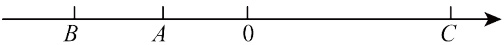

19. （每题4分，共16分）（24-25七年级上·山东威海·阶段练习）
（1）计算：

$\sqrt[3]{0.125}-\sqrt{3\frac{1}{16}}+\sqrt[3]{\left(-\frac{1}{8}\right)^{2}}+\left(\frac{1}{2}\right)^{-2}+\sqrt{(-2)^{2}}$

（2）求 x 值 $4(x-1)^{2}-49=0$

（3）求 x 值 $125(x-3)^{3}+64=0$

（4）如图a，b，c是数轴上三个点A、B、C所对应的实数.

试化简：$\sqrt{b^{2}}+|a-b|-\sqrt[3]{(a+b)^{3}}-\sqrt{(b-c)^{2}}$

> [!question]- 点击查看答案与解析
> 【答案】（1）$5$；（2）$x_1=\frac{9}{2}$，$x_2=-\frac{5}{2}$；（3）$x=\frac{11}{5}$；（4）$-2b-c$
> 
> 【考点】实数的混合运算、平方根、立方根、绝对值化简 → [[【初中数学知识点体系-人教版】#8-3 实数及其简单运算]]
> 
> 【解析】
> **（1）计算：**
> 
> $\sqrt[3]{0.125} = 0.5 = \frac{1}{2}$
> 
> $\sqrt{3\frac{1}{16}} = \sqrt{\frac{49}{16}} = \frac{7}{4}$
> 
> $\sqrt[3]{\left(-\frac{1}{8}\right)^{2}} = \sqrt[3]{\frac{1}{64}} = \frac{1}{4}$
> 
> $\left(\frac{1}{2}\right)^{-2} = 2^2 = 4$
> 
> $\sqrt{(-2)^{2}} = \sqrt{4} = 2$
> 
> 原式 $= \frac{1}{2} - \frac{7}{4} + \frac{1}{4} + 4 + 2 = \frac{2}{4} - \frac{7}{4} + \frac{1}{4} + 6 = \frac{-4}{4} + 6 = -1 + 6 = 5$
> 
> **（2）$4(x-1)^2-49=0$**
> 
> $4(x-1)^2 = 49$
> 
> $(x-1)^2 = \frac{49}{4}$
> 
> $x-1 = \pm\frac{7}{2}$
> 
> $x_1 = 1+\frac{7}{2} = \frac{9}{2}$，$x_2 = 1-\frac{7}{2} = -\frac{5}{2}$
> 
> **（3）$125(x-3)^3+64=0$**
> 
> $125(x-3)^3 = -64$
> 
> $(x-3)^3 = -\frac{64}{125}$
> 
> $x-3 = \sqrt[3]{-\frac{64}{125}} = -\frac{4}{5}$
> 
> $x = 3 - \frac{4}{5} = \frac{15}{5} - \frac{4}{5} = \frac{11}{5}$
> 
> **（4）化简：**
> 
> 由数轴可知：$b < a < 0 < c$
> 
> $\sqrt{b^2} = |b| = -b$（因为 $b<0$）
> 
> $|a-b| = a-b$（因为 $a>b$，所以 $a-b>0$）
> 
> $\sqrt[3]{(a+b)^3} = a+b$（立方根直接去掉根号）
> 
> $\sqrt{(b-c)^2} = |b-c| = c-b$（因为 $b<c$，所以 $b-c<0$）
> 
> 原式 $= (-b) + (a-b) - (a+b) - (c-b)$
> 
> $= -b + a - b - a - b - c + b$
> 
> $= -2b - c$
> 
> 【易错点】负指数运算出错；开平方忘记正负解；绝对值化简时未先判断正负；立方根与平方根混淆。
