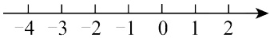

20. （共6分）（24-25七年级上·浙江金华·期中）已知一列数：$-|-3.5|,0,\sqrt{2},-1$

（1）把这4个数表示在下图所示的数轴上；

（2）用"<"将这4个数连接起来。

> [!question]- 点击查看答案与解析
> 【答案】（1）数轴表示略；（2）$-|-3.5| < -1 < 0 < \sqrt{2}$
> 
> 【考点】实数与数轴、实数大小比较 → [[【初中数学知识点体系-人教版】#8-3 实数及其简单运算]]
> 
> 【解析】
> **（1）数轴表示：**
> 
> 先化简各数：
> 
> $-|-3.5| = -3.5$
> 
> $\sqrt{2} \approx 1.414$
> 
> 四个数分别为：$-3.5$、$0$、$1.414$、$-1$
> 
> 在数轴上从左到右依次标出：$-3.5$、$-1$、$0$、$\sqrt{2}$
> 
> **（2）大小比较：**
> 
> 负数 < 0 < 正数
> 
> 两个负数比较，绝对值大的反而小：
> 
> $|-3.5| = 3.5$，$|-1| = 1$，因为 $3.5 > 1$，所以 $-3.5 < -1$
> 
> 所以从小到大排列为：
> 
> $-|-3.5| < -1 < 0 < \sqrt{2}$
> 
> 【易错点】绝对值化简错误；负数比较大小时出错。
