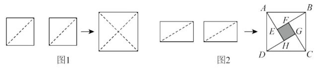

23. （共6分）【问题发现】（1）如图1，把两个边长为1的小正方形分别沿对角线剪开，将所得的4个直角三角形拼在一起，就可以得到一个大正方形，所得到的大正方形的面积为 ___ ，大正方形的边长为 ___ 。

【知识迁移】（2）爱钻研的小思同学受到启发，尝试用两个同样大小的长方形拼出一个正方形．如图2，将两个长和宽分别为3和2的长方形沿对角线剪开，将所得到的4个直角三角形拼出了一个中间有一个镂空小正方形的大正方形，所得到的小正方形EFGH的边长为 ___ ；大正方形ABCD的面积为 ___ ；边长为 ___ ．

【拓展延伸】（3）小明想用一块面积为900 cm²的正方形纸片，沿着边的方向裁出一块面积为740 cm²的长方形纸片，使它的长与宽之比为5:4。请通过计算说明是否可行。

> [!question]- 点击查看答案与解析
> 【答案】（1）面积为 $2$，边长为 $\sqrt{2}$；（2）小正方形边长为 $1$，大正方形面积为 $13$，边长为 $\sqrt{13}$；（3）不可行
> 
> 【考点】算术平方根、无理数的实际应用 → [[【初中数学知识点体系-人教版】#8-1 平方根]]、[[【初中数学知识点体系-人教版】#8-3 实数及其简单运算]]
> 
> 【解析】
> **（1）问题发现：**
> 
> 两个边长为1的小正方形，每个面积为 $1 \times 1 = 1$
> 
> 大正方形的面积 = 两个小正方形面积之和 = $1 + 1 = 2$
> 
> 大正方形的边长 = $\sqrt{2}$
> 
> **（2）知识迁移：**
> 
> 小正方形EFGH的边长 = 长方形的长 - 长方形的宽 = $3 - 2 = 1$
> 
> 大正方形ABCD的面积 = 4个直角三角形的面积 + 小正方形的面积
> 
> 每个直角三角形的面积 = $\frac{1}{2} \times 3 \times 2 = 3$
> 
> 4个直角三角形的面积 = $4 \times 3 = 12$
> 
> 小正方形的面积 = $1 \times 1 = 1$
> 
> 大正方形的面积 = $12 + 1 = 13$
> 
> 大正方形的边长 = $\sqrt{13}$
> 
> **（3）拓展延伸：**
> 
> 正方形纸片的面积为900 cm²，所以边长 = $\sqrt{900} = 30$ cm
> 
> 设长方形的长为 $5x$，宽为 $4x$，则：
> 
> $5x \times 4x = 740$
> 
> $20x^2 = 740$
> 
> $x^2 = 37$
> 
> $x = \sqrt{37}$
> 
> 长方形的长 = $5\sqrt{37}$
> 
> 因为 $6^2 = 36$，$7^2 = 49$，所以 $6 < \sqrt{37} < 7$
> 
> $5\sqrt{37} > 5 \times 6 = 30$
> 
> 即长方形的长大于正方形的边长，所以**不可行**。
> 
> 【易错点】拼图面积计算错误；裁纸问题忽略比较长方形的长与原正方形边长的大小。
