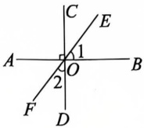

如图， $AB \perp CD$，垂足为 O，EF 为过点 O 的一条直线，则  $\angle 1$ 与 $\angle 2$ 一定具有的关系是().

(A) 相等
(B) 互余
(C) 互补
(D) 互为对顶角

> [!question]- 点击查看答案与解析
> 【答案】(B)
> 
> 【考点】垂直的性质、互余角 → [[【初中数学知识点体系-人教版】#7-1 相交线]]
> 
> 【解析】
> 因为 $AB \perp CD$，所以 $\angle BOC = 90^\circ$。
> 由图可知，$\angle 1$ 和 $\angle 2$ 分别是 $\angle BOC$ 被直线 EF 分成的两个角，所以 $\angle 1 + \angle 2 = 90^\circ$。
> 根据互余的定义：两个角的和为 $90^\circ$，则这两个角互余。
> 因此 $\angle 1$ 与 $\angle 2$ 互余。
> 
> 选项分析：
> - (A) 相等：只有当 EF 恰好平分 $\angle BOC$ 时才成立，不一定成立。
> - (B) 互余：$\angle 1 + \angle 2 = 90^\circ$，一定成立。
> - (C) 互补：互补要求和为 $180^\circ$，不成立。
> - (D) 互为对顶角：对顶角需要两边分别互为反向延长线，$\angle 1$ 和 $\angle 2$ 不是对顶角。
> 
> 【易错点】混淆互余（和为 $90^\circ$）与互补（和为 $180^\circ$）的概念；误认为 $\angle 1$ 和 $\angle 2$ 是对顶角。
