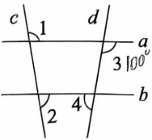

如图，$\angle1+\angle2=180^{\circ}$，$\angle3=100^{\circ}$，则 $\angle4$ 的度数为（）.

第 3 题图 

(A) $70^{\circ}$
(B) $80^{\circ}$
(C) $90^{\circ}$
(D) $100^{\circ}$

> [!question]- 点击查看答案与解析
> 【答案】(D)
> 
> 【考点】平行线性质、对顶角 → [[【初中数学知识点体系-人教版】#7-2 平行线]]
> 
> 【解析】
> 由 $\angle 1 + \angle 2 = 180^\circ$，根据同旁内角互补，可判定两直线平行。
> 由图可知，$\angle 2$ 和 $\angle 3$ 的对顶角是同旁内角，或直接观察：
> $\angle 1$ 和 $\angle 2$ 是同旁内角，$\angle 1 + \angle 2 = 180^\circ$，所以两直线平行。
> 由平行线的性质，同位角相等，$\angle 4$ 与 $\angle 3$ 是同位角，所以 $\angle 4 = \angle 3 = 100^\circ$。
> 
> 【易错点】不能正确识别同位角、内错角、同旁内角；忽略平行线判定需要先验证条件。
