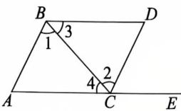

如图, 点 A, C, E 在同一条直线上, 下列条件中能判定 $AB \parallel CD$ 的是().

第 4 题图 

(A) $\angle1 = \angle4$
(B) $\angle3 = \angle4$
(C) $\angle1 = \angle2$
(D) $ \angle D + \angle ACD = 180^{\circ}$

> [!question]- 点击查看答案与解析
> 【答案】(B)
> 
> 【考点】平行线判定（内错角） → [[【初中数学知识点体系-人教版】#7-2 平行线]]
> 
> 【解析】
> 逐项分析：
> - (A) $\angle 1 = \angle 4$：$\angle 1$ 和 $\angle 4$ 不是 AB 和 CD 被某条直线所截形成的内错角或同位角，无法判定 $AB \parallel CD$。
> - (B) $\angle 3 = \angle 4$：$\angle 3$ 和 $\angle 4$ 是 AB 和 CD 被直线 AC 所截形成的内错角，内错角相等，两直线平行，能判定 $AB \parallel CD$。
> - (C) $\angle 1 = \angle 2$：$\angle 1$ 和 $\angle 2$ 是 BD 和 AC 被直线 AB 所截形成的内错角，能判定 $BD \parallel AC$，但不能判定 $AB \parallel CD$。
> - (D) $\angle D + \angle ACD = 180^\circ$：这是 BD 和 AC 被直线 CD 所截的同旁内角，能判定 $BD \parallel AC$，但不能判定 $AB \parallel CD$。
> 
> 【易错点】不能正确识别哪两条直线被哪条直线所截；混淆内错角、同位角、同旁内角对应的直线关系。
