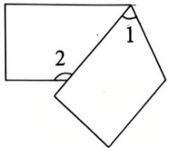

一个长方形纸条按如图所示的方法折叠一下，若 $\angle2=132^{\circ}$，则 $\angle1=$（）.

第 5 题图 

(A) $61^{\circ}$
(B) $66^{\circ}$
(C) $52^{\circ}$
(D) $132^{\circ}$

> [!question]- 点击查看答案与解析
> 【答案】(B)
> 
> 【考点】折叠性质、平行线性质 → [[【初中数学知识点体系-人教版】#7-2 平行线]]
> 
> 【解析】
> 由折叠的性质可知，折叠前后对应角相等。
> 设折叠后与 $\angle 1$ 对应的角为 $\angle 3$，则 $\angle 1 = \angle 3$。
> 因为纸条是长方形，上下两边平行，$\angle 2 = 132^\circ$。
> $\angle 2$ 的邻补角为 $180^\circ - 132^\circ = 48^\circ$。
> 由平行线的性质，内错角相等，$\angle 1 + \angle 3 = 180^\circ - 48^\circ = 132^\circ$。
> 因为 $\angle 1 = \angle 3$，所以 $2\angle 1 = 132^\circ$，$\angle 1 = 66^\circ$。
> 
> 【易错点】忽略折叠前后角相等的性质；不能正确利用平行线的性质建立角度关系。
